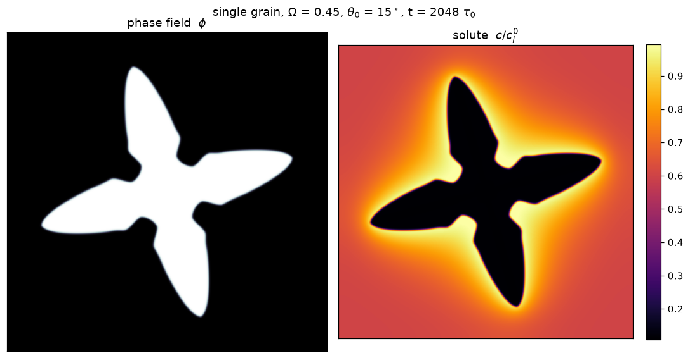
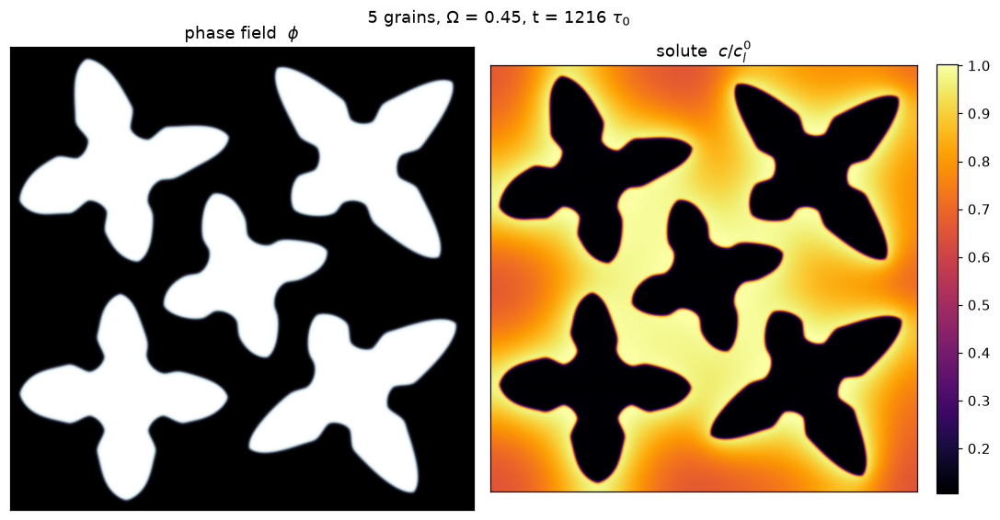

# phasefield-dendrite

A small, quantitative phase-field solver for dendritic solidification of a dilute
binary alloy in 2D. Two files, about 400 lines, numpy + PyTorch, runs on CPU or GPU.



It implements the model of Echebarria, Folch, Karma & Plapp,
[Phys. Rev. E 70, 061604 (2004)](https://doi.org/10.1103/PhysRevE.70.061604):
isothermal free growth into a supersaturated melt, with the anti-trapping current
that makes results independent of the interface width. It is the same model as
PRISMS-PF's `alloy_solidification` application.

## Files

| file | what |
|---|---|
| `phasefield.py` | the solver: one grain, orientation `theta0` as a parameter |
| `multigrain.py` | many grains in a single `phi`, orientation carried per cell |
| `figures.py` | makes the two images in this README |

## Run

With [uv](https://docs.astral.sh/uv/), which builds the environment on first run
(CUDA build of torch on Windows and Linux):

```bash
uv run phasefield.py --omega 0.45 --theta0 15     # prints tip radius and solute drift
uv run multigrain.py --grains 4                   # prints solid fraction per grain
uv run figures.py                                 # writes docs/*.png
```

Without uv: `pip install numpy torch matplotlib`, then `python phasefield.py ...`.

```python
from phasefield import PhaseField
m = PhaseField(n=600, omega=0.45, theta0=15, device='cuda')
m.step(20000)
m.phi, m.U        # torch tensors, (n, n), float64
```

## The model

Two coupled fields: the order parameter `phi` (+1 solid, -1 liquid) and the
dimensionless supersaturation `U`, which starts at `-omega` everywhere in the melt.

    tau0 a_s(n)^2 dphi/dt = div(W^2 grad phi) + anisotropy terms + phi - phi^3 - lambda (1 - phi^2)^2 U
    ((1+k)/2 - (1-k)/2 phi) dU/dt = div(D q(phi) grad U + j_at) + (1 + (1-k)U)/2 dphi/dt

with four-fold anisotropy `a_s = 1 + eps4 cos 4(theta - theta0)`, one-sided diffusion
`q = (1 - phi)/2`, and the anti-trapping flux `j_at`. Lengths are in interface widths
`W0` and times in `tau0`; the coupling is fixed by `lambda = D/a2`, `a2 = 0.6267`,
which cancels interface kinetics.

Numerics: explicit Euler, float64, face-averaged fluxes, zero-flux walls. Total
solute drifts by about 2e-4 relative (`m.solute()`; both scripts print it). The Laplacians use a 9-point isotropic
stencil: the usual 5-point one adds a grid-locked four-fold anisotropy of 13.7% at
`dx = 0.8`, the same size as the physical one; the 9-point stencil brings it to 2.8%.

## Is it for a particular material?

The equations are general; the material enters through a few numbers.

| parameter | default | meaning |
|---|---|---|
| `k` | 0.113 | partition coefficient. 0.113 is **Al–7wt% Si**, the alloy of the CA model in [DendriteModel](https://github.com/jaavedakram/DendriteModel) |
| `omega` | 0.45 | supersaturation, (c_l^eq - c_inf)/(c_l^eq - c_s^eq): how far the melt is from equilibrium |
| `eps4` | 0.05 | strength of the four-fold surface-energy anisotropy |
| `Dtilde` | 2.0 | solute diffusivity in units of W0^2/tau0 |

The output is dimensionless. To put it in metres and seconds for a given alloy, take
its capillary length `d0` and liquid diffusivity `D_l`; then `W0 = lambda d0 / a1`
(`a1 = 0.8839`, so `W0 = 3.61 d0` with the defaults) and `tau0 = Dtilde W0^2 / D_l`.

Two caveats if you want a specific alloy rather than a generic dendrite. `eps4 = 0.05`
is stronger than the 0.01–0.02 measured for aluminium; it gives cleaner needles.
And this is free growth into an undercooled melt, isothermal: no imposed thermal
gradient or pulling speed, so it is not directional solidification.

## Many grains



A single `phi` holds every grain; each cell stores its orientation as
`(cos 4theta0, sin 4theta0)` and inherits it from its solid neighbours, once, as it
starts to solidify. Cost per cell does not grow with the number of grains. Grains
interact through the shared solute field: the centre grain above is boxed in by its
neighbours' rejected solute and grows smallest.

Limit: one `phi` has no grain-boundary energy, so grains that touch simply merge.
That is right for soft, solutal impingement and wrong after contact;
`MultiGrain.touching()` reports when it happens.

## Validity

Quantitative for `omega` in about 0.35–0.45 with the defaults. Below that the solute
boundary layer `D/V` outgrows a 600-cell domain; above it the tip radius falls to a few
`W0` and the thin-interface asymptotics stop holding. Inside the window the tip
velocity matches the 2D Ivantsov relation to within +0.6% (omega 0.35) and -2.3%
(0.45).

## License

MIT
